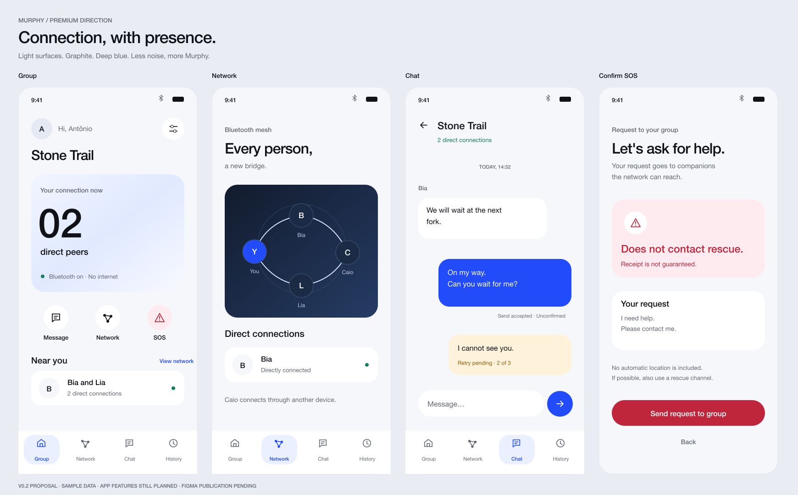
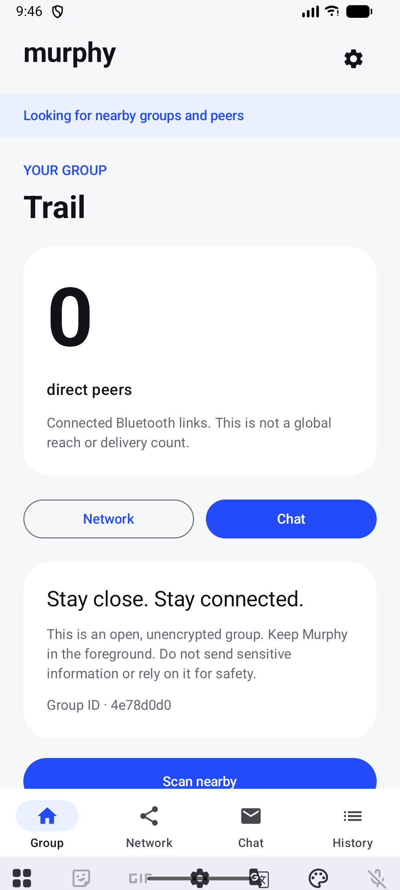
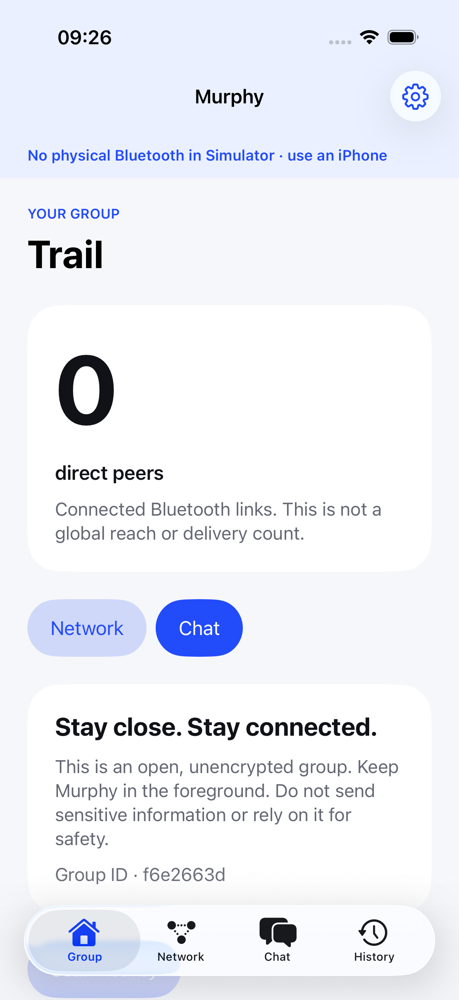

# Murphy

Murphy is a peer-to-peer BLE mesh network for outdoor activities such as hiking and surfing. It is designed for communication when there is no internet or cellular coverage, with shared networking logic across Android and iOS through Kotlin Multiplatform.

The shared domain core and native radio adapters establish:

- a connection state machine;
- a small, testable mesh packet router with TTL and duplicate protection;
- a deterministic topology simulator for relay failures and rerouting;
- an offline event history with a replaceable store;
- routing decision events that make forwarding, delivery and drops visible to the UI;
- a shared transport coordinator that bridges BLE connections and routing decisions;
- per-peer send outcomes, so a failed link does not stop attempts on other links.

**Current delivery status:** Android (Jetpack Compose) and iPhone (SwiftUI) now
use native BluetoothGatt/CoreBluetooth adapters and a shared KMP `RadioSession`,
not preview state. They discover open groups, establish GATT links and attempt
group message transmission/relay using the shared binary protocol.
**Physical Android↔iPhone interoperability is not yet validated.** Destination
ACK, durable storage, authentication/encryption, background radio and functional
SOS remain unimplemented. Keep this development build in the foreground; never
send sensitive information or rely on it for safety.
See the [status and testing guide](docs/testing.md) and
[seven-track delivery plan](docs/implementation-plan.md).

**Product language:** all app-owned UI text must be English, regardless of device
language. The proposed screens are now in English, including errors and SOS
warnings. User names and user-authored messages are not translated automatically.

## Project direction

- Kotlin Multiplatform shared module;
- native Bluetooth adapters per platform;
- offline-first operation;
- no dependency on a central server for peer-to-peer messaging;
- explicit state and event history for debugging and emergency scenarios;
- a storage seam that lets each platform persist the same event model offline.

The project is in native radio integration and is planned as a candidate for the JetBrains KMP Contest 2027. Competition success cannot be guaranteed.

The competition thesis and release bar are documented in [docs/competition-thesis.md](docs/competition-thesis.md).
The decentralized topology decision is documented in [docs/architecture.md](docs/architecture.md).

## Design before implementation

Every upcoming UI increment starts with a visual proposal for review, then
implementation and verification. Update this README and the development vault
with the change, rationale, checks and remaining limitations.

The current premium proposal covers 16 mobile screens and their main
offline/failure states. See the [premium direction](docs/design/premium/README.md)
and [screen plan](docs/design/README.md). The earlier green proposal is preserved
for comparison.



Complete review boards: [onboarding](docs/design/premium/01-entrada.svg.png),
[network](docs/design/premium/02-rede.svg.png),
[messaging and SOS](docs/design/premium/03-mensagens-sos.svg.png),
[history and settings](docs/design/premium/04-historico-ajustes.svg.png).

These boards are **static product concepts**. The native app implements a subset
with real navigation and native radio callbacks, not invented remote peers.
Native system fonts support text scaling; the palette remains graphite/white/cobalt.
Sending accepted by an adapter must never be presented as destination acknowledgement.

[Figma workspace](https://www.figma.com/design/25gjH4lJelpFg5jJEhWICm): created on
2026-10-05. The Starter MCP quota was exhausted before screen construction;
browser import attempts were unstable. The complete boards have **not** been
verified in Figma. The versioned SVG sources and PNG previews are the design
reference, not a completed Figma prototype.
On 2026-10-14, metadata access worked again, but the page was empty. Complete
Figma publication remains pending. The next write again hit the Starter quota;
the web canvas did not finish loading. No paid plan or sharing setting was changed.
The local premium boards are the disclosed implementation reference, not a claim
that editable Figma screens were delivered. Track 1 has no completion commit.

## Layout

```text
shared/
  src/commonMain/   platform-independent domain and routing logic
  src/commonTest/   deterministic unit tests
androidApp/         Android Compose app + BluetoothGatt adapter + UI tests
iosApp/             iPhone SwiftUI app + CoreBluetooth adapter + UI tests
```

`RadioSession` serializes real native callbacks through `MeshSession` and the
shared router. Group broadcasts deliver locally and relay to peers except the
incoming link, with hop TTL and a bounded 4,096-ID session cache. This is not
durable deduplication or authenticated replay protection. History remains in memory.

The [development wire specification](docs/radio-protocol.md) describes GATT
UUIDs, group IDs, bounded fragmentation, handshake and local acceptance semantics.
Every phone can relay; no required group leader exists. The per-link role
tie-break only selects a sending connection when two roles coexist.

`MeshTransportCoordinator` currently uses bounded flooding: it forwards a
message to every attached peer except the peer that sent it. TTL and duplicate
protection prevent loops while a route-table strategy is still being developed.

Expected adapter failures use `BleSendException`. A forwarding result lists only
peers whose adapters accepted the send, alongside failures for the other peers.
`NoRoute` means no eligible peer is attached; it does not prove the destination
is globally unreachable. Cancellation propagates to the caller.

The separate suspend-based `MeshTransportCoordinator` is still a tested core
contract: its retry scheduler is **not wired into the current native adapters**.
Expected failed sends through that coordinator are queued per message and peer. `MeshRetryPolicy`
defaults to three total attempts, a one-second delay, 128 pending entries and
a 60-second local pending-send lifetime from the first failed attempt.
The platform calls `retryPending(atMillis)` using its session clock; there is
no background worker in the core. Retries reuse the already-routed envelope,
so TTL is unchanged and incoming-message deduplication remains active.
Detached peers wait for reconnection without consuming attempts, but expire
at the same deadline. `expirePending(atMillis)` can reclaim stale work without
sending; `retryPending` also expires it before selecting due work, and scheduling
a failed send reclaims expired capacity. Expiry emits `RetryStopReason.EXPIRED`
and is reported separately in `MeshRetryResult.expired`. There is no automatic
timer: cleanup requires a platform call using the same consistent local clock.
Remote creation timestamps do not control queue age. The queue
is in memory; no-route messages and unattempted sends interrupted by cancellation
are not queued. Destination acknowledgements are not implemented yet.

## Local verification

Use JDK 21 and the included Gradle 8.9 wrapper (official SHA-256 pinned). Gradle
9.3.1 could run the JVM tests but failed when exporting the pinned Kotlin 2.1.10
native framework. Android Java/Kotlin bytecode targets are explicitly Java 17.
The first run downloads the
distribution and dependencies. Run the shared core tests on JVM with:

```bash
./gradlew :shared:jvmTest
```

In this increment, **50 shared tests passed on JVM and 50 on the iOS arm64 simulator**,
including codec/framing, three-node packet relay and no-false-ACK tests.
The Android APK, iPhone simulator and unsigned device apps built with native
adapters. **Two UI tests passed per virtual platform.** Full evidence and
physical-device procedures are in [docs/testing.md](docs/testing.md).
Logic tests exchange packets in memory, not physical BLE. On a machine configured for
the native targets, the broader test entry point is:

```bash
./gradlew :shared:allTests
```

Verify the approved English design copy with Node.js:

```bash
node scripts/design-copy.mjs
```

This checks 710 text nodes across nine SVG boards against
`docs/design/english-copy.json`. It is a design-copy guard, not a localization
system wired to a running application. See [docs/testing.md](docs/testing.md)
for current commands and the future physical-device acceptance checklist.

## Run the native development apps

Android: set `ANDROID_HOME`, install SDK Platform 35 and open the repository in
Android Studio. Select `androidApp` and Run on an emulator or an authorized phone.
CLI build: `./gradlew :androidApp:assembleDebug`.

iPhone: on an Apple Silicon Mac with JDK 21/Xcode, open
`iosApp/Murphy.xcodeproj`, select the **Murphy** scheme and an iPhone simulator,
then Run. A build phase generates the static KMP `Shared.framework` for the
selected SDK/configuration. For a physical phone, choose your own signing team
in Xcode and complete device pairing/Developer Mode yourself. No signing identity
is checked in. Intel iPhone simulators are not configured in the app host yet.

On device A, enter **Your name** and **Group name**, then **Create group**.
On device B, enter your name, **Find nearby groups**, select the discovered
group and **Join group**. Approve Bluetooth permissions yourself and keep both
apps open. **Scan nearby** refreshes a bounded 10-second discovery window.
Allow handshake completion before sending from **Chat** in both directions.
Group names are labels: joining the same public UUID matters, not creating a
second group with the same name.

Only actual connected links count as peers. With no peer, Chat says **Not sent ·
no connected peers**. A successful native write says **Bluetooth accepted ·
receipt unconfirmed**, never destination Delivered/ACK. There is no automatic
retry after reconnection yet. Messages/activity (100 each), groups (32) and
peer links are bounded in memory; process restart loses state.

Going into background closes radio links; resume may require another scan.
The iPhone simulator explicitly has no physical radio, so test transmission on
actual phones. **SOS not available yet** explains that no emergency alert,
location or rescue request is sent. No Internet/server dependency is added.

## Native UI captures

Captured in virtual-device UI tests, not generated mockups. More states and
capture provenance are in [docs/screenshots](docs/screenshots/README.md).

See [capture provenance](docs/screenshots/README.md); virtual-device captures
are UI evidence only, never proof of Bluetooth delivery.



